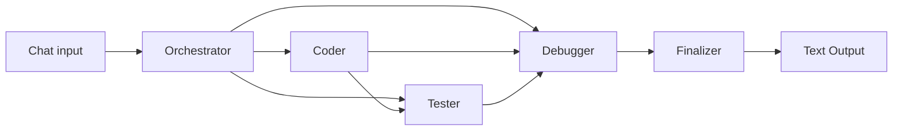

# AI-Workforce

**A browser-based, five-agent software workflow for Python, JavaScript, and TypeScript.**  
**سير عمل برمجي داخل المتصفح يتكوّن من خمسة وكلاء ويدعم Python وJavaScript وTypeScript.**

AI-Workforce is a ZeroAgent Studio workflow that turns a natural-language programming request into a technical specification, source code, a proposed test suite, a static review/correction pass, and a final delivery report.

AI-Workforce هو سير عمل على ZeroAgent Studio يحوّل الطلب البرمجي المكتوب باللغة الطبيعية إلى مواصفات تقنية، ثم كود واختبارات مقترحة ومراجعة ساكنة، وينتهي بتقرير تسليم.

**Version:** 1.0  
**Platform:** [ZeroAgent Studio](https://sakurablush.github.io/zeroagent-studio/)  
**AI provider:** [OpenRouter](https://openrouter.ai/)  
**Configured model:** `deepseek/deepseek-chat`

## The five agents | الوكلاء الخمسة

| Agent | Role |
|---|---|
| Orchestrator — المنسّق | Interprets the request, chooses a language/runtime, and writes a structured SPEC. |
| Coder — المبرمج | Implements the SPEC and produces the complete source module. |
| Tester — المختبر | Designs pytest tests for Python or Jest tests for JavaScript/TypeScript. |
| Debugger — المصحّح | Performs static analysis/simulation against the proposed tests and suggests a minimal correction. |
| Finalizer — المنهي | Packages the module, tests, verification commands, coverage notes, and limitations into a final report. |

## Workflow architecture | بنية سير العمل

The export contains **7 nodes and 9 connections**: one Chat input, five Agent nodes, and one Text Output node. Agent outputs are passed to downstream agents as context; this is a context-chained pipeline.

يحتوي التصدير على **7 عقد و9 روابط**: عقدة Chat واحدة، وخمسة وكلاء، وعقدة Text Output. تنتقل مخرجات الوكلاء إلى الوكلاء اللاحقين كسياق، أي أن البنية عبارة عن خط معالجة متسلسل بالسياق.



## Language and test formats | اللغات والاختبارات

- **Python 3.11:** pytest test files.
- **JavaScript on Node.js 20:** Jest test files.
- **TypeScript 5 (strict mode):** Jest test files with TypeScript setup.

The workflow generates test files and performs a static reasoning/trace pass. It does **not** execute `pytest`, `jest`, or the generated code in a real runtime.

- **Python 3.11:** ملفات اختبارات pytest.
- **JavaScript على Node.js 20:** ملفات اختبارات Jest.
- **TypeScript 5 بوضع strict:** ملفات Jest مع إعداد TypeScript.

ينشئ سير العمل ملفات الاختبارات ويجري مراجعة وتتبعاً منطقياً ساكناً. لكنه **لا يشغّل فعلياً** `pytest` أو `jest` أو الكود الناتج داخل بيئة تنفيذ حقيقية.

## Requirements | المتطلبات

- A browser compatible with ZeroAgent Studio.
- An OpenRouter account and API key.
- Access to `deepseek/deepseek-chat` through OpenRouter, plus sufficient credits or an applicable allowance.
- Do not assume the configured model is free; check current availability and pricing before running.

- متصفح متوافق مع ZeroAgent Studio.
- حساب OpenRouter ومفتاح API.
- إمكانية الوصول إلى `deepseek/deepseek-chat` عبر OpenRouter، مع رصيد أو سماح استخدام مناسب.
- لا تفترض أن النموذج مجاني؛ تحقق من توفره وسعره قبل التشغيل.

Model page: https://openrouter.ai/deepseek/deepseek-chat/api

## Import into ZeroAgent Studio | الاستيراد

1. Download `ai-workforce.multilang-plus.zeroagent.json` from this repository.
2. Open [ZeroAgent Studio](https://sakurablush.github.io/zeroagent-studio/).
3. Save/export any workflow currently open before importing; importing may replace the current canvas.
4. Select **Import**, choose the downloaded JSON file, and confirm the import.
5. Open **Privacy & keys** and add your OpenRouter key in the application settings. Never place the key in prompts, node text, or this repository.
6. Enter a small request in the Chat node and review the final result in Text Output.

1. حمّل ملف `ai-workforce.multilang-plus.zeroagent.json` من هذا المستودع.
2. افتح [ZeroAgent Studio](https://sakurablush.github.io/zeroagent-studio/).
3. احفظ أو صدّر أي سير عمل مفتوح قبل الاستيراد؛ فقد يؤدي الاستيراد إلى استبدال محتوى لوحة العمل الحالية.
4. اختر **Import**، ثم ملف JSON الذي حمّلته، وأكّد عملية الاستيراد.
5. افتح **Privacy & keys** وأضف مفتاح OpenRouter من إعدادات التطبيق. لا تضع المفتاح في التعليمات أو نصوص العقد أو هذا المستودع.
6. اكتب طلباً بسيطاً في عقدة Chat وراجع النتيجة في Text Output.

## Known notes | ملاحظات معروفة

- The Orchestrator prompt still describes the system as a **4-agent** factory, although the export contains five Agent nodes.
- The Finalizer node's internal role metadata still reads `Debugger round 2 — delivery`; its label and prompt identify it as the Finalizer.
- The Debugger performs static analysis/simulation only. Generated code and tests must be reviewed and executed separately before relying on them.
- No OpenRouter API key was found in the inspected export. Keep credentials in ZeroAgent Studio's key settings; do not commit secrets.
- No license file is included. Do not assume redistribution or commercial-use permissions without an explicit license.

- ما زالت تعليمات Orchestrator تصف النظام بأنه يتكوّن من **أربعة وكلاء**، رغم أن الملف يحتوي على خمسة وكلاء.
- ما زال حقل الدور الداخلي للـFinalizer يحمل النص `Debugger round 2 — delivery`، بينما يعرّفه الاسم والتعليمات بأنه Finalizer.
- ينفّذ Debugger تحليلاً ومحاكاة ساكنة فقط. يجب مراجعة الكود والاختبارات وتشغيلهما بصورة منفصلة قبل الاعتماد عليهما.
- لم يظهر مفتاح OpenRouter في النسخة التي فُحصت. احتفظ ببيانات الاعتماد في إعدادات ZeroAgent Studio ولا ترفع الأسرار إلى المستودع.
- لا يتضمن المشروع ملف ترخيص؛ لا تفترض السماح بإعادة التوزيع أو الاستخدام التجاري دون ترخيص صريح.

## Repository contents | محتويات المستودع

```text
.
├── README.md
└── ai-workforce.multilang-plus.zeroagent.json
```

## License | الترخيص

No license is currently included. All rights remain with the respective rights holder unless a license is added.  
لا يوجد ترخيص مرفق حالياً؛ تبقى الحقوق لصاحبها ما لم تتم إضافة ترخيص واضح.
